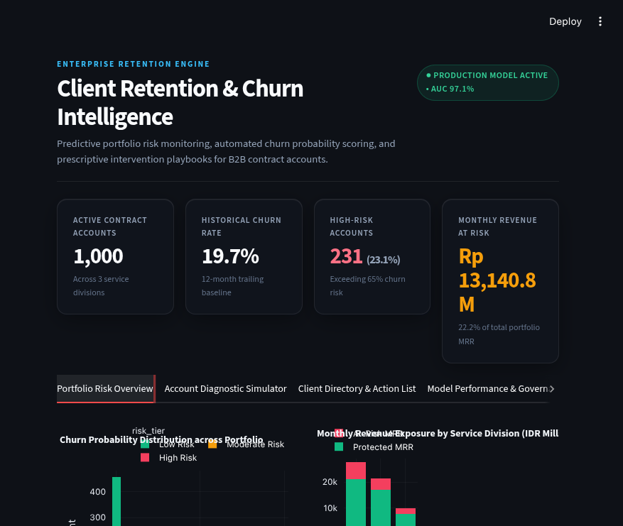
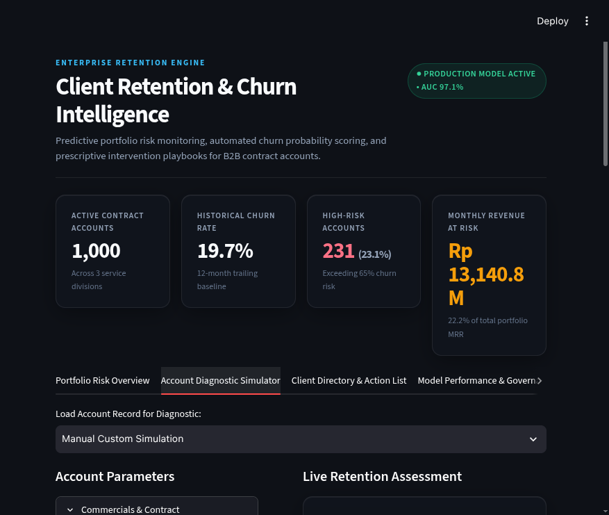

# Enterprise B2B Customer Retention & Churn Intelligence

[](https://www.python.org/)
[](https://streamlit.io/)
[](https://scikit-learn.org/)
[](LICENSE)
[](https://github.com/davinmaritza/b2b-retention-intelligence/actions)

An end-to-end Machine Learning intelligence platform designed to predict, interpret, and prevent contract non-renewals across corporate retainer portfolios (custom enterprise software, dedicated AI squads, and digital marketing retainers).



---

## The Business Problem

In enterprise B2B service firms and digital consultancies, customer churn is structurally distinct from high-volume B2C subscription models:
- **High Contract Value (MRR)**: Losing a single high-tier account can instantly erase tens of millions in monthly recurring revenue.
- **Leading Indicator Latency**: Churn risk compounds across multiple touchpoints—unsettled invoices, unresolved scope creep, stakeholder turnover, and declining CSAT—long before a client formally terminates an SLA.
- **Intervention Window**: Account leaders require transparent early-warning signals at least 60–90 days prior to contract expiration to execute relationship recovery strategies.

This platform bridges predictive machine learning with Explainable AI (XAI) and prescriptive playbooks to safeguard corporate contract revenue.

---

## System Architecture & Features



### 1. Realistic B2B Portfolio Data Generation
Simulates calibrated enterprise contract accounts ($N=1,000$) with cross-domain business variables:
- **Commercials**: Monthly Retainer (MRR in IDR Millions), Contract Term (3, 6, 12 months), Partnership Tenure, Marketing Budget Fluctuations.
- **Operations & Billing Health**: Average Invoice Payment Latency (days), Cumulative Unpaid Invoices, Support/Revision Ticket Volume, Critical SLA Breaches.
- **Stakeholder Dynamics**: Scope Creep Index, Key Decision-Maker (PIC) Turnover, Quarterly Business Review (QBR) Attendance, Stakeholder CSAT Score (1–10).

### 2. Multi-Model Benchmarking & Selection
Evaluates candidate architectures under class-imbalanced cross-validation:
- **Logistic Regression with L2 Regularization**: Fully calibrated, interpretable linear probability baseline.
- **Random Forest Classifier**: Non-linear tree ensemble capturing complex interaction effects.
- **HistGradientBoosting Classifier**: Optimized gradient boosted decision trees with native imbalance weighting.

| Model Architecture | ROC-AUC | F1-Score | Precision | Recall |
| :--- | :---: | :---: | :---: | :---: |
| **Logistic Regression (Production)** | **0.9706** | **0.7360** | **0.6053** | **0.9388** |
| HistGradientBoosting | 0.9323 | 0.7327 | 0.7115 | 0.7551 |
| Random Forest | 0.8971 | 0.6055 | 0.5500 | 0.6735 |

### 3. Explainable AI & Human-Readable Attribution
Instead of opaque black-box scoring, the engine isolates exact feature attributions for individual accounts:
- Attributions are automatically translated into executive business language (e.g., `Critical SLA Breaches`, `Stakeholder CSAT (1-10)`, `Invoice Settlement Delay`).
- Bidirectional impact labeling clarifies whether each factor stabilizes the account or elevates non-renewal hazard.

### 4. Interactive Decision-Support Dashboard
- **Portfolio Risk Overview**: Aggregated revenue-at-risk exposure, churn distribution, and cross-metric scatter analytics.
- **What-If Diagnostic Simulator**: Collapsible multi-parameter stress-testing with instant probability recalculation.
- **Contract Portfolio Directory**: Real-time account search, division/risk filtering, and high-risk CSV export for Account Executives.
- **Model Governance**: Comparative evaluation metrics and global factor weight rankings.

---

## Quickstart Guide

### Prerequisites
- Python 3.10, 3.11, or 3.12
- Git

### 1. Clone the Repository
```bash
git clone https://github.com/davinmaritza/b2b-retention-intelligence.git
cd b2b-retention-intelligence
```

### 2. Set Up Virtual Environment
```bash
python -m venv .venv
source .venv/bin/activate  # On Windows: .venv\Scripts\activate
pip install -r requirements.txt
```

### 3. Run Pipeline Training (CLI)
Generate synthetic dataset and train candidate benchmark models:
```bash
python -m src.model_pipeline
```
*Trained model artifacts, preprocessors, and explainer configurations are automatically saved to `models/best_model.joblib`.*

### 4. Launch the Web Application
```bash
streamlit run app.py
```
Open your browser at `http://localhost:8501`.

### 5. Execute Test Suite
```bash
pytest -v tests/
```

---

## Project Structure
```text
b2b-retention-intelligence/
├── .github/
│   └── workflows/
│       └── ci.yml             # GitHub Actions CI matrix workflow
├── assets/                    # Interface previews and architecture diagrams
│   ├── dashboard_preview.png
│   └── diagnostic_simulator.png
├── app.py                     # Streamlit application interface (Apple HIG dark theme)
├── pyproject.toml             # Project build configuration & pytest options
├── requirements.txt           # Python dependency pins
├── LICENSE                    # MIT License
├── README.md                  # System architecture & documentation
├── src/
│   ├── __init__.py
│   ├── data_generator.py      # B2B portfolio synthetic data engine
│   ├── explainer.py           # Standalone XAI & feature attribution explainer
│   └── model_pipeline.py      # Multi-model benchmarking, preprocessing & evaluation
├── tests/
│   └── test_pipeline.py       # Unit and pipeline regression tests
├── data/                      # Dataset persistence directory
└── models/                    # Serialized model artifacts (.joblib)
```

---

## License
Distributed under the MIT License. See [LICENSE](LICENSE) for more details.
